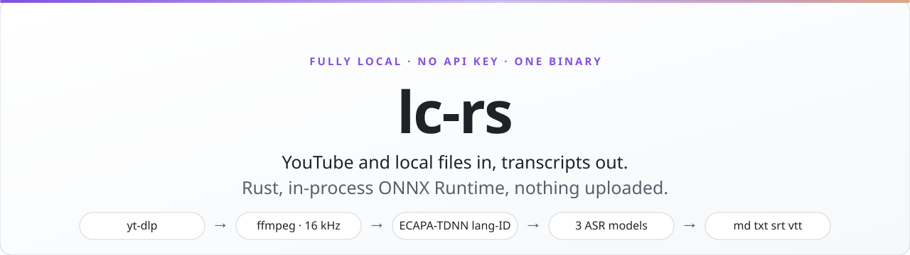
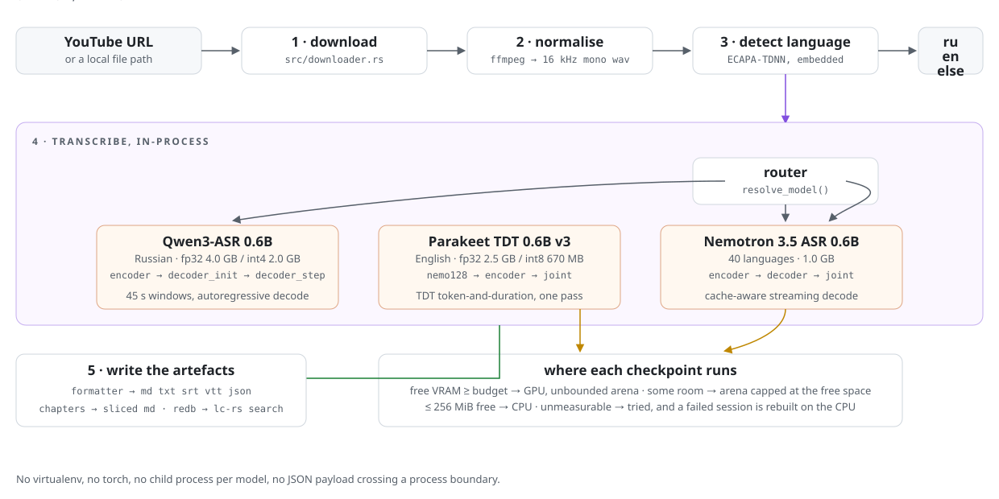
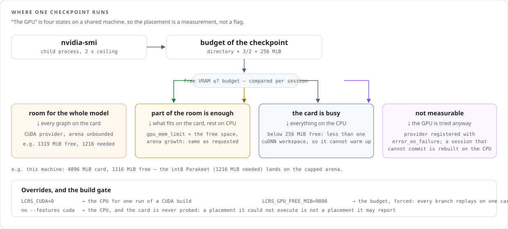
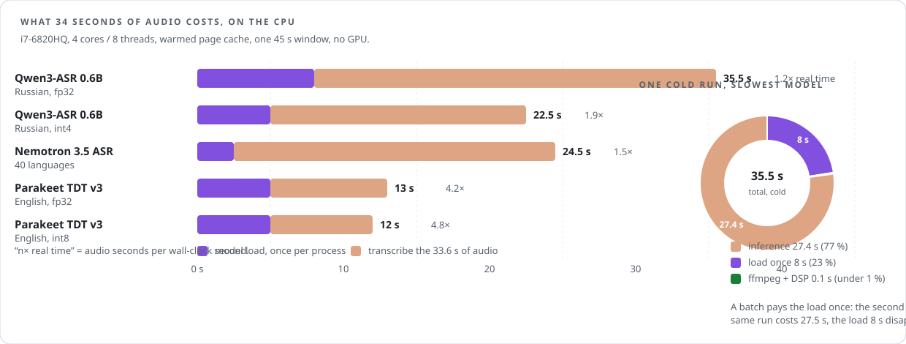

<div align="center">



<p>
  <a href="https://github.com/Githab-capibara/lc-rs/actions/workflows/ci.yml"></a>
  <a href="LICENSE"></a>
  <a href="https://www.rust-lang.org/"></a>
  
  
  
</p>
<p>
  <a href="https://github.com/Githab-capibara/lc-rs/stargazers"></a>
  <a href="https://github.com/Githab-capibara/lc-rs/issues"></a>
  <a href="https://github.com/Githab-capibara/lc-rs/commits/main"></a>
</p>

```bash
cargo install --path . && lc-rs doctor --fix
```

</div>

> [!TIP]
> Local, offline transcription for YouTube, Vimeo, Twitch and [1000+ other
> sites](https://github.com/yt-dlp/yt-dlp/blob/master/supportedsites.md)
> via `yt-dlp`, plus any video or audio file on disk. Paste a URL or a
> path; get a `.md` transcript by default (`--output-format` adds `.txt`,
> `.srt`, `.vtt` or `.json`) without an API key and without uploading audio
> to the cloud. An ECAPA-TDNN language-ID model picks between
> [Qwen3-ASR](https://huggingface.co/Qwen/Qwen3-ASR-0.6B),
> [Parakeet TDT](https://huggingface.co/nvidia/parakeet-tdt-0.6b-v3) and
> [Nemotron 3.5 ASR](https://huggingface.co/nvidia/nemotron-3.5-asr-streaming-0.6b).

`lc-rs` is a tiny orchestrator over five stages:

| Stage | Tool |
|---|---|
| Download the best audio | [`yt-dlp`](https://github.com/yt-dlp/yt-dlp) (YouTube, Vimeo, Twitch, 1000+ sites) |
| Re-encode to 16 kHz mono WAV | [`ffmpeg`](https://ffmpeg.org/) |
| Detect the language | ECAPA-TDNN classifier (45 languages), embedded in the binary |
| Transcribe locally | Qwen3-ASR 0.6B · Parakeet TDT 0.6B v3 · Nemotron 3.5 ASR 0.6B |
| Write and index the artefacts | `md`/`txt`/`srt`/`vtt`/`json` + the `redb` search index |

Nothing is uploaded to a third-party service. No OpenAI / Google / DeepL
keys required. Unlike pasting a clip into ChatGPT or calling the Whisper
API, transcription stays on your laptop after the download.

This is a **from-scratch Rust port** of the Python project
`localcaption`. The command surface, the artefacts and the routing
decisions are one-to-one; the Python virtualenvs and the `torch` runtimes
are gone.

The English path is byte-identical to the reference: the same fixture
yields the same `.json`, `.md`, `.txt`, `.srt` and `.vtt` files, down to
the punctuation. The Russian path reaches a word error rate of 0.267 and
the multilingual one 0.167 against the reference's own transcripts — and on
the multilingual fixture the port is the more accurate of the two.

## Installation

```bash
git clone https://github.com/Githab-capibara/lc-rs
cd lc-rs
cargo build --release
install -Dm755 target/release/lc-rs ~/.local/bin/lc-rs

lc-rs doctor --fix          # install ffmpeg / yt-dlp, fetch the checkpoints
```

Requirements: Rust 1.98+, `ffmpeg`, `yt-dlp`, a C compiler with `cmake` (the
TLS provider and ONNX Runtime's build-time downloader compile C), and ~7.7 GB
of disk for the four required checkpoints. The optional quantised variants of
the Russian and the English model add 2.0 GB and 670 MB. See
[docs/operations/01-installation.md](docs/operations/01-installation.md).

### With CUDA

```bash
cargo build --release --features cuda
```

CUDA is opt-in; the default build has no CUDA dependency and cannot fail
because of a missing toolkit.

With the feature compiled in, the GPU is tried first and the placement
falls back on its own: each checkpoint is measured against the card's free
VRAM, so a 4 GB card shared with a local LLM server gets whatever room is
left and the rest of the model runs on the CPU, while a full card is left
alone. Nothing has to be configured. The build still needs the CUDA 13
runtime on the machine; without it the run prints one warning and stays on
the CPU. `lc-rs doctor` reports the card, the provider and the placement of
every installed model — see
[docs/adr/17-place-inference-by-the-measured-vram-budget.md](docs/adr/17-place-inference-by-the-measured-vram-budget.md).

## Usage

```bash
# A YouTube video, language detected automatically.
lc-rs https://www.youtube.com/watch?v=dQw4w9WgXcQ

# A local file, Russian forced, every output format.
lc-rs lecture.mp4 -l ru --output-format all -o ./out

# A batch of videos, resumable after an interruption.
lc-rs --batch urls.txt -o ./out

# Search what you have transcribed so far.
lc-rs search "climate policy"
```

The console shows the run and keeps stdout for the artefacts:

```console
$ lc-rs intro.wav -l en --model parakeet-tdt-0.6b-v3 --output-format all
 INFO ffmpeg: re-encoding to 16000 Hz mono WAV
 INFO done (English, parakeet-tdt-0.6b-v3)
transcript files:
   txt: out/intro.txt      srt: out/intro.srt
   vtt: out/intro.vtt      json: out/intro.json
    md: out/intro.md

─────────────────────────────── transcript ─
The birch canoe slid on the smooth planks. Glue the sheet to the dark blue
background. It is easy to tell the depth of a well. ...
```

The transcript lands in `./transcripts/<stem>.md`:

```markdown
Питаю, що твоя країна може зробити для тебе. Я питаю, що ти можеш зробити для своєї країни.

## Timestamps

- `00:00:00,000` — Питаю, що твоя країна може зробити для тебе. Я питаю, що ти можеш зробити для своєї країни.
```

### Commands

| Command | Purpose |
|---|---|
| `lc-rs <url-or-file>` | transcribe a video (the default command) |
| `lc-rs --batch FILE` | transcribe every URL in a list, sequentially |
| `lc-rs doctor [--fix]` | diagnose the install and repair what is missing |
| `lc-rs model list\|download\|rm\|info` | manage the local checkpoints |
| `lc-rs search <term>` | search the past transcripts |

Every flag is documented in
[docs/api/01-command-line-interface.md](docs/api/01-command-line-interface.md).

## The models

| Model | Role | Size | Source |
|---|---|---|---|
| `langid-ecapa` | language identification, 45 languages | 84 MB | embedded in the binary |
| `qwen3-asr-0.6b` | Russian | 4.0 GB | [`andrewleech/qwen3-asr-0.6b-onnx`](https://huggingface.co/andrewleech/qwen3-asr-0.6b-onnx) |
| `qwen3-asr-0.6b-int4` | Russian, quantised — smaller and faster, less faithful | 2.0 GB | [`andrewleech/qwen3-asr-0.6b-onnx`](https://huggingface.co/andrewleech/qwen3-asr-0.6b-onnx) |
| `parakeet-tdt-0.6b-v3` | English | 2.5 GB | [`istupakov/parakeet-tdt-0.6b-v3-onnx`](https://huggingface.co/istupakov/parakeet-tdt-0.6b-v3-onnx) |
| `parakeet-tdt-0.6b-v3-int8` | English, quantised — smaller, less faithful | 670 MB | [`istupakov/parakeet-tdt-0.6b-v3-onnx`](https://huggingface.co/istupakov/parakeet-tdt-0.6b-v3-onnx) |
| `nemotron-3.5-asr-streaming-0.6b` | multilingual, 40 languages | 1.0 GB | [`DimQ1/nemotron-3.5-asr-streaming-0.6b-onnx-int8-cpu`](https://huggingface.co/DimQ1/nemotron-3.5-asr-streaming-0.6b-onnx-int8-cpu) |

`qwen3-asr-0.6b-int4` and `parakeet-tdt-0.6b-v3-int8` are optional: `--all`
does not fetch them and their absence never fails a check. Pick them with
`lc-rs --model qwen3-asr-0.6b-int4` or
`lc-rs --model parakeet-tdt-0.6b-v3-int8` on a machine that cannot afford
the 7.2 GiB the fp32 Qwen decoder and the 2.7 GiB the fp32 Parakeet encoder
need. The measurements behind the choices are in
[ADR 10](docs/adr/10-ship-the-fp32-qwen-decoder.md) and
[ADR 12](docs/adr/12-ship-the-fp32-parakeet-export.md).

```bash
lc-rs model download --all
```

Every artefact is pinned by size *and* SHA-256, so a truncated or
substituted download is detected instead of being loaded. The downloads are
resumable.

## Architecture



Every model runs **in-process** through ONNX Runtime: no virtualenv, no
`torch`, no child process, no JSON payload crossing a process boundary. The
front-end is fused into the FFT loop, so a 30-second window is mel-spectrogrammed
without a second pass over the samples.

The pipeline stage by stage:
[docs/design/01-pipeline-stages.md](docs/design/01-pipeline-stages.md) ·
the decisions behind it:
[docs/adr/01-run-models-in-process-through-onnx-runtime.md](docs/adr/01-run-models-in-process-through-onnx-runtime.md),
[docs/adr/13-load-every-model-once-per-process.md](docs/adr/13-load-every-model-once-per-process.md),
[docs/adr/14-fuse-the-mel-front-end-into-the-fft-loop.md](docs/adr/14-fuse-the-mel-front-end-into-the-fft-loop.md).

## Where the inference runs



A workstation's card is not a dedicated resource, so the placement is a
measurement rather than a flag. `src/gpu.rs` probes `nvidia-smi` — a child
process, because the crate forbids `unsafe` and takes no NVML binding —
and asks each checkpoint for what it needs: its whole directory
`× 3/2 + 256 MiB`.

- a session that **fits** gets the CUDA provider with an unbounded arena;
- a session that **partly fits** gets the arena capped at the free space, so
  the runtime uses the room that exists and the rest stays on the CPU;
- a card with **less than 256 MiB** free is left alone — that is under one
  cuDNN workspace, and a placement that cannot warm up is worse than none;
- an **unmeasurable** card is still tried, and a session that then cannot be
  committed is rebuilt on the CPU.

Two safety nets make a wrong budget survivable: the provider is registered
with `error_on_failure()`, so a missing CUDA runtime is an error we recover
from rather than ORT's silent downgrade, and a session that fails to *commit*
on the GPU is rebuilt with no provider and committed again.

`LCRS_CUDA=0` forces the CPU for one run; `LCRS_GPU_FREE_MIB=<MiB>` replaces
the measurement, which is how all four branches are replayed on one card:

```bash
# a card with room for the whole checkpoint
LCRS_GPU_FREE_MIB=9000 lc-rs lecture.mp4
# a card that is full: everything on the CPU
LCRS_GPU_FREE_MIB=100 lc-rs lecture.mp4
```

What a run would decide right now is one line of `lc-rs model info <key>`,
and the whole table is under `lc-rs doctor`'s *GPU placement* heading —
the card, the provider's verdict, and every installed checkpoint.

## Performance



Measured on this repository's own machine — an i7-6820HQ, 4 cores / 8
threads, warmed page cache, one 45-second window, CPU-only:

| Model | Role | Load, once per process | Transcribe 33.6 s | Real time |
|---|---|---|---|---|
| `parakeet-tdt-0.6b-v3-int8` | English, quantised | 5 s | 7 s | 4.8&#215; |
| `parakeet-tdt-0.6b-v3` | English, fp32 | 5 s | 8 s | 4.2&#215; |
| `qwen3-asr-0.6b-int4` | Russian, quantised | 5 s | 17.5 s | 1.9&#215; |
| `qwen3-asr-0.6b` | Russian, fp32 | 8 s | 27.5 s | 1.2&#215; |
| `nemotron-3.5-asr-streaming-0.6b` | multilingual | 2.5 s | 22 s | 1.5&#215; |

"n&#215; real time" is audio seconds per wall-clock second; the numbers are
medians of batch runs, where the second item of the batch pays no load —
which is exactly what a batch of forty videos does. The front-end costs
under 0.15 s of it: `ffmpeg` re-encodes in 71 ms on this fixture and the
fused mel loop adds 13–17 ms per 30-second window.

Accuracy lives in the decision records rather than in a benchmark table: the
English path is byte-identical to the reference implementation, and the
Russian and multilingual word error rates against its transcripts are
[ADR 10](docs/adr/10-ship-the-fp32-qwen-decoder.md) and
[ADR 12](docs/adr/12-ship-the-fp32-parakeet-export.md).

## Configuration

Every setting is an environment variable. The `LCRS_` prefix wins over the
original `LOCALCAPTION_` one, so an existing setup keeps working.

| Variable | Default | Purpose |
|---|---|---|
| `LCRS_PROXY` | `socks5h://127.0.0.1:9050` | the SOCKS5 proxy for every outbound request |
| `LCRS_MODELS_DIR` | `$XDG_DATA_HOME/lc-rs/models` | where the checkpoints live |
| `LCRS_INDEX_PATH` | `$XDG_DATA_HOME/lc-rs/index.redb` | where the search index lives |
| `LCRS_THREADS` | the number of logical CPUs | the ONNX Runtime thread count |
| `LCRS_CUDA` | on | in a `--features cuda` build: the GPU is tried first; `0` (or `false`, `no`, `off`) forces the CPU for one run |
| `LCRS_GPU_FREE_MIB` | — | free VRAM in MiB, forced instead of measured; replays every placement branch on one card |

The full list is in
[docs/api/02-configuration.md](docs/api/02-configuration.md).

## Documentation

Everything lives in [`docs/`](docs) (master index:
[docs/README.md](docs/README.md)):

| Folder | Contents |
|---|---|
| [docs/adr](docs/adr/README.md) | Architecture Decision Records: in-process ONNX Runtime, the graph optimisation level, per-model exports, language routing, CLI parity, the search index, the proxy policy, CUDA, the reproduced reference quirks, and the VRAM placement |
| [docs/design](docs/design/README.md) | The mechanisms: pipeline stages, model selection, the three ASR backends, output formats, batch and playlists, chapters and search, local summaries |
| [docs/api](docs/api/README.md) | The CLI reference, the configuration and the error model |
| [docs/models](docs/models/README.md) | The model registry and the language identification |
| [docs/operations](docs/operations/README.md) | Installation and `doctor --fix` |
| [docs/assets](docs/assets/README.md) | The diagrams this README and the documentation embed |

### Key entry points

| Page | What it answers |
|---|---|
| [docs/design/01-pipeline-stages.md](docs/design/01-pipeline-stages.md) | What does a run actually do, and what files come out? |
| [docs/api/01-command-line-interface.md](docs/api/01-command-line-interface.md) | Every flag and subcommand |
| [docs/adr/01-run-models-in-process-through-onnx-runtime.md](docs/adr/01-run-models-in-process-through-onnx-runtime.md) | Why is there no Python in this port? |
| [docs/adr/02-pin-the-onnx-graph-optimisation-level.md](docs/adr/02-pin-the-onnx-graph-optimisation-level.md) | Why is the optimisation level pinned? |
| [docs/design/03-qwen3-asr-backend.md](docs/design/03-qwen3-asr-backend.md) | How does the Russian model actually work? |
| [docs/adr/09-reproduce-the-reference-front-end-quirks.md](docs/adr/09-reproduce-the-reference-front-end-quirks.md) | Which reference behaviours are reproduced on purpose? |
| [docs/adr/13-load-every-model-once-per-process.md](docs/adr/13-load-every-model-once-per-process.md) | Why does a batch load each checkpoint once, not once per file? |
| [docs/adr/14-fuse-the-mel-front-end-into-the-fft-loop.md](docs/adr/14-fuse-the-mel-front-end-into-the-fft-loop.md) | How did the front-end get 4.7&#215; faster without changing a bit? |
| [docs/adr/17-place-inference-by-the-measured-vram-budget.md](docs/adr/17-place-inference-by-the-measured-vram-budget.md) | When does a model run on the video card, and when does it stay on the CPU? |

## Development

```bash
cargo build --release
cargo test --all-features
cargo clippy --all-targets --all-features
cargo fmt --all
```

The crate denies warnings, forbids unsafe code and lints pedantic:

```toml
[lints.rust]
unsafe_code = "forbid"
missing_debug_implementations = "deny"

[lints.clippy]
all = { level = "deny", priority = -1 }
pedantic = { level = "deny", priority = -1 }
```

Formatting, clippy, tests, the release build and a job that greps `src/` for
`unsafe` behind the compiler's back all run in
[CI](.github/workflows/ci.yml), on both the current toolchain and the pinned
MSRV 1.98.
The pedantic lints that the audio and model code opts out of are listed in
one place, with the reasoning, at the top of
[`src/lib.rs`](src/lib.rs) — the crate also builds `cargo doc` without a
warning.

The unit tests run without any model. The end-to-end tests need the
checkpoints and are marked `#[ignore]`:

```bash
lc-rs model download --all
cargo test --release -- --ignored
```

The mel front-end is checked numerically against the reference
`transformers` extractor (`tests/features_parity.rs`), and the transcripts
against the reference wording (`tests/asr_golden.rs`).

The front-end's optimisation is pinned by a unit test as well: the
pre-optimisation implementation is kept in `src/ml/features.rs`'s test module
as the golden reference, and
`mel_spectrogram_is_bit_identical_to_the_dense_implementation` compares the
two bit for bit — the speed-up has to come from the data movement, never
from the arithmetic.

## Licence

MIT — see [LICENSE](LICENSE).

The model checkpoints are distributed by their respective authors under
their own licences.